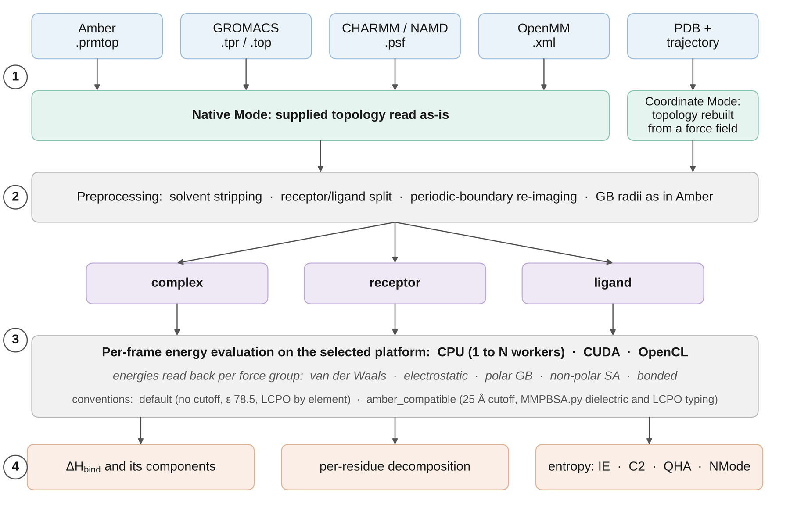

OpenGBSA
========

**OpenGBSA** computes MM/GBSA binding enthalpies from molecular dynamics (MD)
trajectories. All energies are computed with `OpenMM <https://openmm.org>`_, on
CPUs or on GPUs through CUDA or OpenCL. OpenGBSA reads Amber, GROMACS,
CHARMM/NAMD and OpenMM input as well as plain PDB files. It is installed with
one conda command and needs no AmberTools installation.

   The four steps of an OpenGBSA run. (1) Input: Native Mode reads the
   topology of the MD simulation, and Coordinate Mode builds one from a force
   field. (2) Preprocessing: solvent stripping, receptor/ligand split,
   periodic-boundary re-imaging and GB radii. (3) Energy evaluation of the
   complex, the receptor and the ligand for every frame. (4) Output: the
   binding enthalpy and its terms, the per-residue decomposition and an
   optional entropy estimate.

Features
--------

* **Two interfaces.** A command-line interface (CLI) writes configuration
  templates, checks the installation and downloads test data. A
  configuration-driven interface (CDI) defines the whole calculation in one
  YAML file, which ``opengbsa config.yaml`` runs. See :doc:`user_guide/interfaces`.
* **Many input formats.** Amber ``.prmtop``, GROMACS ``.top``/``.tpr``,
  CHARMM/NAMD ``.psf``, a serialised OpenMM System ``.xml``, or a PDB file of
  the complex. See :doc:`user_guide/input_formats`.
* **Five Generalized Born models.** HCT, OBC1, OBC2, GBn and GBn2, with salt
  screening and two non-polar models (LCPO and ACE).
* **Amber-compatible mode.** ``amber_compatible: true`` reproduces the
  conventions of Amber MMPBSA.py, so results can be compared directly with
  published MMPBSA.py values.
* **Per-residue decomposition.** The contribution of every receptor residue,
  per frame and on average, with plots, an interactive HTML report and a PyMOL
  script that colours the hot-spot residues.
* **Entropy estimates.** Interaction entropy and its second-order cumulant
  (C2) with their reliability limits, quasi-harmonic and normal-mode analysis.
* **GPU acceleration.** CUDA and OpenCL come with OpenMM. On the CPU the frames
  are divided among worker processes.

Where to start
--------------

.. grid:: 2

    .. grid-item-card::  Installation
        :link: installation
        :link-type: doc

        Install OpenGBSA with conda and check that it works.

    .. grid-item-card::  Quickstart
        :link: quickstart
        :link-type: doc

        Run a first calculation on a bundled protein-ligand system in a few
        minutes.

    .. grid-item-card::  Testing and validation
        :link: testing
        :link-type: doc

        Step by step from a clean machine to the unit tests and the
        third-party validation cases, with the expected results.

    .. grid-item-card::  Configuration reference
        :link: user_guide/configuration
        :link-type: doc

        Every option of the configuration file, with its default and its
        meaning.

    .. grid-item-card::  Tutorials
        :link: tutorial/index
        :link-type: doc

        Six worked examples: protein-ligand, protein-peptide, protein-protein,
        protein-RNA, protein-DNA and antibody-antigen.

    .. grid-item-card::  Theory
        :link: theory/index
        :link-type: doc

        MM/GBSA, the GB models, the Born-radius cutoff and the entropy
        estimators.

.. toctree::
   :maxdepth: 2
   :caption: Getting started
   :hidden:

   installation
   quickstart
   testing

.. toctree::
   :maxdepth: 2
   :caption: User guide
   :hidden:

   user_guide/index

.. toctree::
   :maxdepth: 2
   :caption: Tutorials
   :hidden:

   tutorial/index

.. toctree::
   :maxdepth: 2
   :caption: Theory and methods
   :hidden:

   theory/index

.. toctree::
   :maxdepth: 1
   :caption: Reference
   :hidden:

   api_reference
   changelog
   contributing

Citing OpenGBSA
---------------

Please cite OpenGBSA with the metadata in
`CITATION.cff <https://github.com/Bio-Otto/opengbsa/blob/main/CITATION.cff>`_,
and the software it is built on:

* OpenMM: Eastman P et al. (2024) OpenMM 8: molecular dynamics simulation with
  machine learning potentials. *J Phys Chem B* 128:109--116.
* MDTraj: McGibbon RT et al. (2015) MDTraj: a modern open library for the
  analysis of molecular dynamics trajectories. *Biophys J* 109:1528--1532.
* ParmEd: Shirts MR et al. (2017) Lessons learned from comparing molecular
  dynamics engines on the SAMPL5 dataset. *J Comput Aided Mol Des* 31:147--161.
