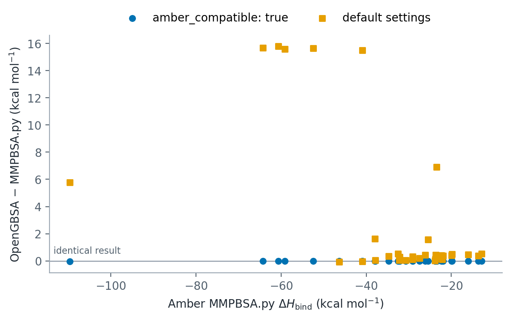

Testing and validation
======================

This page leads from a clean machine to four levels of evidence that OpenGBSA
works: the installation check, the unit tests, a complete example run and the
third-party validation cases with their expected results. Each step lists the
command, what it should print and how long it takes.

.. list-table::
   :header-rows: 1
   :widths: 28 22 18 32

   * - Step
     - Download
     - Time
     - Shows
   * - 1. Install and check
     - about 1 GB (conda)
     - 5-10 min
     - OpenGBSA and OpenMM import and run
   * - 2. Unit tests
     - none (10 GB optional)
     - 1-5 min
     - |unit_tests| tests of the code paths
   * - 3. Quickstart
     - none
     - 5 min (GPU)
     - a full calculation with all outputs
   * - 4. Validation cases
     - 25 MB to 9 GB per case
     - minutes to hours
     - agreement with recorded results and with Amber MMPBSA.py

.. |unit_tests| replace:: 129

Step 1: install and check
-------------------------

Install the conda package as described in :doc:`installation`, then:

.. code-block:: bash

    conda activate opengbsa
    opengbsa --version
    opengbsa --check-deps            # ends with "All dependencies are available!"
    python -m openmm.testInstallation  # lists the platforms that work

Step 2: unit tests
------------------

The tests are in the repository. Clone the release that is installed and add
pytest to the environment:

.. parsed-literal::

    git clone https://github.com/Bio-Otto/opengbsa.git
    cd opengbsa
    git checkout v\ |release|
    conda install -n opengbsa -c conda-forge pytest
    python -m pytest test/unit -q

The repository contains the topologies of the test systems but not their
trajectories. Without them, the 13 tests that need a trajectory are skipped and
the run ends with ``116 passed, 13 skipped``. The skipped tests and their reasons
are listed with ``python -m pytest test/unit -q -rs``. To run them as well,
download the test trajectories (10 GB, Zenodo record
`10.5281/zenodo.22139199 <https://doi.org/10.5281/zenodo.22139199>`_) from the
root of the repository and run the tests again:

.. code-block:: bash

    opengbsa --list-test-data
    opengbsa --fetch-test-data --only core-fixtures
    python -m pytest test/unit -q        # 128 passed, 1 skipped

The one remaining test reads an OpenMM System built from the 3dd2 validation
case. It runs after the data of that case are downloaded (Step 4, 44 MB), and
then all 129 tests pass.

The data are cached in ``~/.cache/opengbsa`` and linked into ``test/data/``.
The tests cover, among others:

* the five GB models and their radii, against Amber-written topologies;
* the non-polar term (LCPO with element and Amber typing) against ``sander``;
* reading Amber, GROMACS, CHARMM/NAMD, OpenMM XML and PDB input;
* periodic-boundary re-imaging of multi-chain complexes;
* the per-residue decomposition on the serial and parallel paths;
* the entropy estimators against gmx_MMPBSA's implementation;
* the platform choice and the CPU/GPU fallback;
* configuration validation and the runner from configuration to results.

Step 3: quickstart
------------------

:doc:`quickstart` runs a protein-ligand complex that ships with the repository.
From the repository root:

.. code-block:: bash

    opengbsa examples/quickstart/quickstart.yaml

Expected: ``Mean binding energy (Enthalpy): -24.99 ± 4.60 kcal/mol`` over 50
frames, and the output files listed on the quickstart page.

Step 4: third-party validation cases
------------------------------------

Six datasets published by other groups, and two generated for the OpenGBSA
paper, cover six classes of complexes and all input formats. The six
third-party datasets ship as ready-to-run cases in ``test/configs/``. Each case
folder holds a ``fetch_data.sh`` that downloads the data from Zenodo, a
configuration file and a ``README.md`` with the provenance.

``test/configs/check_validation.py`` runs a case and compares the mean binding
enthalpy with the expected value. List the cases with:

.. code-block:: bash

    python test/configs/check_validation.py --list

.. list-table::
   :header-rows: 1
   :widths: 18 40 10 12 10 10

   * - Case
     - System and input
     - Frames
     - Download
     - Expected
     - MMPBSA.py
   * - ``3dd2``
     - protein-RNA, Amber ``.prmtop`` (Native Mode)
     - 300
     - 44 MB
     - -16.575
     - -23.493
   * - ``irf11``
     - protein-DNA, multi-model PDB (Coordinate Mode)
     - 101
     - 25 MB
     - -103.845
     - -109.623
   * - ``ctla4``
     - protein-peptide, NAMD/CHARMM ``.psf`` (Native Mode)
     - 300
     - 321 MB
     - -32.056
     - -32.571
   * - ``1gcq``, ``2oob``
     - protein-protein, GROMACS coordinates (Coordinate Mode)
     - 300
     - 1.4 GB each
     - -36.300, -23.898
     - -37.921, -25.472
   * - ``3clpro_*``
     - seven protein-ligand complexes, Amber ``.prmtop``
     - 300
     - 9.1 GB (all)
     - see ``--list``
     - see ``--list``
   * - ``vrc01_*``
     - antibody-antigen, CHARMM ``.psf``, five variants
     - 300
     - 1.05 GB each
     - see ``--list``
     - see ``--list``

All values are mean binding enthalpies in kcal/mol. "Expected" is OpenGBSA at
its default settings with the case's configuration. "MMPBSA.py" is Amber
MMPBSA.py on the same frames, the reference for a run with
``amber_compatible: true``.

**Run a case.** The smallest case, 3dd2, takes about a minute on a GPU:

.. code-block:: bash

    cd test/configs/rna_protein_test
    ./fetch_data.sh                  # 44 MB from Zenodo 10.5281/zenodo.6973437
    python prepare_system.py         # receptor and ligand topologies
    cd ../../..
    python test/configs/check_validation.py 3dd2
    python test/configs/check_validation.py 3dd2 --amber-compatible

The two checks print, for example:

.. code-block:: text

    OpenGBSA validation cases, default settings (opengbsa):
      3dd2: dH =   -16.575   expected   -16.575   difference +0.000 kcal/mol   PASS
    1 of 1 cases passed
    OpenGBSA validation cases, amber_compatible (opengbsa):
      3dd2: dH =   -23.493   Amber MMPBSA.py   -23.493   difference +0.000 kcal/mol   PASS
    1 of 1 cases passed

A case passes when the difference is within 0.02 kcal/mol. If the data of a
case are missing, the script prints the commands that prepare them.
``python test/configs/check_validation.py all`` runs every case whose data are
present.

**Why the two settings differ.** At its default settings OpenGBSA computes each
atom's Born radius from every atom pair. Amber MMPBSA.py includes only atoms
within 25 Å. ``amber_compatible: true`` applies the same cutoff, the solvent
dielectric of MMPBSA.py and Amber's LCPO parameters, and then reproduces
MMPBSA.py. The difference at default settings grows with the size of the
complex, up to about 16 kcal/mol for the antibody complexes
(:doc:`theory/mmgbsa_theory`).

   OpenGBSA minus Amber MMPBSA.py for the validation runs of the OpenGBSA
   paper, on identical frames. With ``amber_compatible: true`` (circles) every
   run agrees to within 0.02 kcal/mol. At default settings (squares) the
   Born-radius cutoff of MMPBSA.py makes the difference, which is largest for
   the antibody-antigen complexes on the left.

Step 5 (optional): reproduce the paper
--------------------------------------

The OpenGBSA paper also used two datasets generated for it, nine OXA-family
complexes and five anti-PD-1 antibody complexes. Their trajectories, all
configurations, the Amber MMPBSA.py inputs and outputs, and the scripts that
make every table and figure are in the data deposit cited in the paper.

Reporting a problem
-------------------

Please open an issue at https://github.com/Bio-Otto/opengbsa/issues with the
command, the configuration file and the log.
