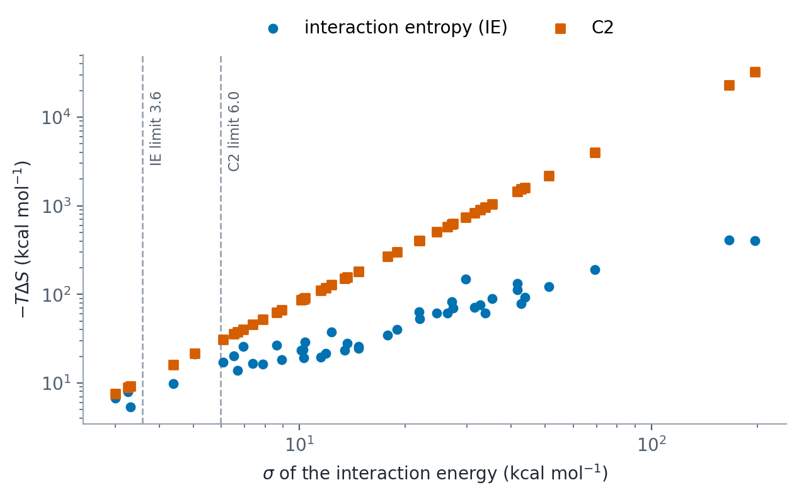

Entropy Methods
===============

The entropic contribution (:math:`-T\Delta S`) is the most challenging component of free energy calculations. It represents the loss of translational, rotational, and vibrational degrees of freedom upon binding. OpenGBSA offers four methods to estimate this term.

1. Interaction Entropy (IE)
---------------------------

The Interaction Entropy method approximates the entropy change directly from the fluctuations of the gas-phase receptor--ligand interaction energy along the MD trajectory, :math:`\Delta E_{int} = \Delta E_{vdW} + \Delta E_{elec}` (the per-frame ``delta_vdw`` and ``delta_elec`` columns). The solvation terms of the binding enthalpy are not part of :math:`\Delta E_{int}`, as in Duan et al. and gmx_MMPBSA.

**Theory**:
Derived from the rigorous Zwanzig relation, it avoids the assumption of Gaussian distribution of conformations.

.. math::

   -T\Delta S_{IE} = kT \ln \langle e^{\beta \Delta E_{int}^{fluct}} \rangle

Where :math:`\Delta E_{int}^{fluct} = \Delta E_{int} - \langle \Delta E_{int} \rangle`.

*   **Pros**:
    *   **Computationally Efficient**: Requires only the interaction energies (already calculated for enthalpy) and simple post-processing.
    *   **No Diagonalization**: Does not require matrix diagonalization.
*   **Cons**:
    *   **Convergence**: The exponential average cannot be converged in practice when the standard deviation :math:`\sigma` of :math:`\Delta E_{int}` exceeds 15 kJ/mol (3.6 kcal/mol). OpenGBSA reports :math:`\sigma` and flags larger values.
*   **Citation**: Duan, L., et al. (2016). Interaction entropy: A new paradigm for computing binding free energy. *Journal of the American Chemical Society*, 138(17), 5722-5728.

Second-order cumulant (C2)
~~~~~~~~~~~~~~~~~~~~~~~~~~

Expanding the exponential average to second order gives

.. math::

   -T\Delta S_{C2} = \frac{\sigma^2}{2kT}

which converges much faster than IE but becomes unrealistically large when :math:`\sigma` exceeds 25 kJ/mol (6.0 kcal/mol). Select it with ``entropy_method: c2``. OpenGBSA reports both estimates with :math:`\sigma` whichever method is selected.

*   **Citation**: Ekberg, V., & Ryde, U. (2021). On the use of interaction entropy and related methods to estimate binding entropies. *Journal of Chemical Theory and Computation*, 17(8), 5379-5391.

How reliable are these estimates?
~~~~~~~~~~~~~~~~~~~~~~~~~~~~~~~~~

OpenGBSA reports the standard deviation :math:`\sigma` of the interaction
energy with both estimates and marks an estimate as unreliable above its limit.
In the 45 runs of the OpenGBSA paper :math:`\sigma` lay between 3.0 and 197
kcal/mol. Only three small-molecule complexes were below the IE limit and five
runs below the C2 limit; for antibody and nucleic-acid complexes both estimates
reached hundreds to tens of thousands of kcal/mol. OpenGBSA's values agree with
those of gmx_MMPBSA's routines on the same energies to within 0.24 kcal/mol.

   :math:`-T\Delta S` by interaction entropy and C2 against :math:`\sigma` of
   the interaction energy, for the 45 validation and application runs of the
   OpenGBSA paper (log scales). The dashed lines are the reliability limits of
   Ekberg and Ryde (2021).

For most protein-protein and protein-nucleic acid complexes the binding
enthalpy is therefore the more useful quantity.

2. Quasi-Harmonic Analysis (QHA)
--------------------------------

QHA (or Principal Component Analysis - PCA) estimates the configurational entropy by fitting a multi-variate Gaussian to the distribution of conformations sampled in the trajectory.

**Theory**:
It diagonalizes the mass-weighted covariance matrix of atomic fluctuations. The entropy is calculated from the eigenvalues (:math:`\lambda_i`) of this matrix.

.. math::

   S_{config} \approx k_B \sum_{i} \left[ \frac{1}{2}\ln(1 + \frac{k_B T e^2}{\hbar^2 \omega_i^2}) \right]

*   **Pros**:
    *   **Anharmonicity**: Captures some anharmonic motions and correlations between atoms.
*   **Cons**:
    *   **Sampling**: Requires that the simulation is long enough to sample the relevant phase space. If the trajectory is too short (fewer frames than degrees of freedom), the entropy will be underestimated.
*   **Citation**: Karplus, M., & Kushick, J. N. (1981). Method for estimating the configurational entropy of macromolecules. *Macromolecules*, 14(2), 325-332.
*   **In OpenGBSA** (``entropy_method: quasiharmonic``): the absolute
    entropy of the ligand over the evaluated frames. With
    ``qha_analyze_complex: true`` the receptor and the complex are analysed as
    well, and the binding entropy :math:`T\Delta S = TS_\mathrm{complex} -
    TS_\mathrm{receptor} - TS_\mathrm{ligand}` is added to
    :math:`\Delta G`. The quasi-harmonic estimate has not been compared with
    Amber's implementation.

3. Normal Mode Analysis (NMode)
-------------------------------

NMode treats the complex, the receptor and the ligand each as an ideal gas of
rigid rotors and harmonic oscillators.

**Theory**:
Each species is minimized to a local energy minimum. The Hessian matrix (second
derivatives of the potential energy) of the minimum is mass-weighted and
diagonalized to obtain the vibrational frequencies :math:`\nu_i`. Statistical
mechanics at 1 atm then gives the translational, rotational and vibrational
entropy of each species; the vibrational part is

.. math::

   S_{vib} = R \sum_{i} \left[ \frac{h\nu_i/kT}{e^{h\nu_i/kT} - 1} - \ln(1 - e^{-h\nu_i/kT}) \right]

and the binding entropy is

.. math::

   -T\Delta S = -T\left(S_\mathrm{complex} - S_\mathrm{receptor} - S_\mathrm{ligand}\right).

*   **Pros**:
    *   **Standard Reference**: The most established method in MM/PBSA literature, and the one of MMPBSA.py and gmx_MMPBSA.
    *   **Independent of the interaction-energy fluctuation** that limits IE and C2.
*   **Cons**:
    *   **Expensive**: Minimization and Hessian diagonalization for large systems is slow, so only a subset of frames is used.
    *   **Approximation**: The harmonic approximation may fail for highly flexible biomolecules, and the result depends on the local minimum reached from each frame.
*   **In OpenGBSA** (``entropy_method: nmode`` with ``run_entropy_analysis:
    true``): ``nmode_frames`` frames spread evenly over the analysed frames
    are used. In each, the complex, the receptor and the ligand are minimized
    until the root-mean-square gradient is below ``nmode_drms``; a frame in
    which one of them does not reach it is left out and reported. The energy
    function is the run's MM/GB function without the non-polar term. The
    Hessian comes from central finite differences of the OpenMM forces. On
    CUDA and OpenCL, ``nmode_precision: mixed`` minimizes first in mixed
    precision, finishes in double precision and takes the Hessian in mixed
    precision (displacement 0.0003 nm); ``double`` uses double precision
    throughout (displacement 0.00001 nm). CPU runs use the double-precision
    Reference platform. The thermochemistry follows Amber's nmode program:
    the six lowest modes are skipped, the rotational symmetry number is 1,
    and an imaginary mode adds no entropy. The mean :math:`-T\Delta S` and
    its standard deviation over frames are added to :math:`\Delta G`, and
    every frame's terms are written to ``nmode_entropy.csv``.
*   **With amber_compatible**: the energy function is that of MMPBSA.py's
    nmode calculation, run by Amber's NAB program: HCT GB (``nmode_igb=1``)
    with the radii of the topology, no salt (``nmode_istrng=0``), a
    Born-radius cutoff of 15 Å (NAB's default ``rgbmax``), a solvent
    dielectric of 78.5 and no non-polar term. The temperature is 298.15 K,
    which MMPBSA.py fixes for this term.
*   **Validation** (3CLpro with baicalein, 4,712 atoms, AmberTools 24.8,
    ``amber_compatible: true``): at the same minima of frame 29701, the
    entropies of the complex, the receptor and the ligand from a
    double-precision Hessian agree with those of Amber's nmode program within
    0.02 cal/(mol K), and :math:`-T\Delta S` is 17.82 kcal/mol against
    Amber's 17.81 kcal/mol. The mixed-precision Hessian gives 17.98 kcal/mol.
    Minimizations that start from the same frame can end in different
    minima, even within one program: Amber's nab program run directly on
    frame 29701 gives 14.72 kcal/mol, and MMPBSA.py gives 18.88 kcal/mol for
    the same frame. Per-frame values are therefore
    compared through their mean over frames. Over frames 29701, 29801 and
    29901, MMPBSA.py gives 19.36 ± 0.61 kcal/mol and OpenGBSA 20.04 ± 2.49
    kcal/mol (standard deviation over frames). The translational and
    rotational terms agree within 0.002 kcal/mol. OpenGBSA needed 16 to 19
    minutes per frame on an NVIDIA GeForce RTX 2080 SUPER in mixed precision;
    MMPBSA.py needed 3.2 hours for the three frames on three MPI processes of
    an Intel Core i9-9900K, one frame each.
*   **Citation**: Miller, B. R., et al. (2012). MMPBSA.py: An efficient program for end-state free energy calculations. *Journal of Chemical Theory and Computation*, 8(9), 3314-3321.
