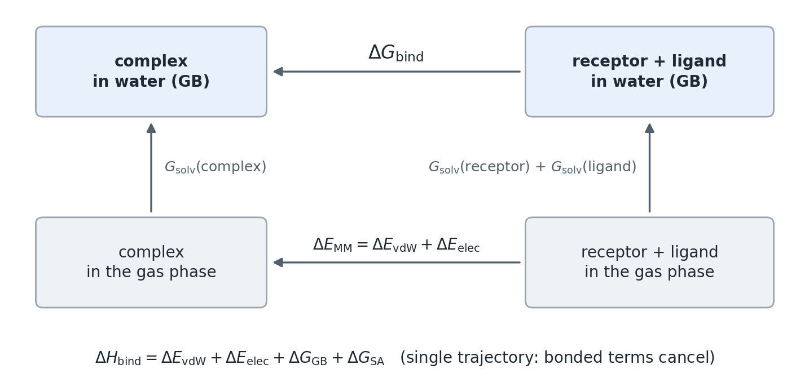

MM/GBSA
=======

MM/GBSA (molecular mechanics with Generalized Born and surface-area
solvation) estimates the binding free energy of a receptor and a ligand from
MD snapshots. It evaluates only the end states, the complex and the separated
receptor and ligand, which makes it much cheaper than alchemical free-energy
methods and more accurate than docking scores (Genheden and Ryde 2015).

The thermodynamic cycle
-----------------------

.. math::

   \Delta G_\mathrm{bind} = G_\mathrm{complex} - \left( G_\mathrm{receptor} + G_\mathrm{ligand} \right)

Each free energy is an average over snapshots and, for one snapshot, is
approximated as

.. math::

   G = E_\mathrm{MM} + G_\mathrm{solv} - TS

where :math:`E_\mathrm{MM}` is the gas-phase molecular mechanics energy
(bonded, van der Waals and electrostatic terms), :math:`G_\mathrm{solv}` the
solvation free energy and :math:`-TS` the entropy contribution.

   Binding in water is computed as binding in the gas phase plus the change of
   solvation free energy.

Single trajectory
-----------------

OpenGBSA takes the receptor and ligand coordinates from the frames of the
complex trajectory. The bonded terms of the complex then equal those of the
receptor and the ligand and cancel exactly, and the binding enthalpy of a frame
is

.. math::

   \Delta H_\mathrm{bind} = \Delta E_\mathrm{vdW} + \Delta E_\mathrm{elec}
   + \Delta G_\mathrm{GB} + \Delta G_\mathrm{SA}

These are the columns ``delta_vdw``, ``delta_elec``, ``delta_gb`` and
``delta_sa`` of the per-frame output (:doc:`../user_guide/outputs`). The
electrostatic and van der Waals terms use no cutoff.

Solvation
---------

The solvation free energy has a polar and a non-polar part,
:math:`G_\mathrm{solv} = G_\mathrm{polar} + G_\mathrm{nonpolar}`.

The **polar part** comes from a GB model (:doc:`gb_models`):

.. math::

   G_\mathrm{GB} = -\frac{1}{2}\left(\frac{1}{\varepsilon_\mathrm{in}} -
   \frac{e^{-\kappa f_\mathrm{GB}}}{\varepsilon_\mathrm{out}}\right)
   \sum_{i,j} \frac{q_i q_j}{f_\mathrm{GB}(r_{ij}, R_i, R_j)}, \qquad
   f_\mathrm{GB} = \sqrt{r_{ij}^2 + R_i R_j \exp\left(-\frac{r_{ij}^2}{4 R_i R_j}\right)}

with the effective Born radii :math:`R_i`, the solute and solvent dielectric
constants and the Debye-Hückel screening parameter :math:`\kappa`.

The **non-polar part** is a linear function of the solvent-accessible surface
area, :math:`G_\mathrm{nonpolar} = \gamma \cdot \mathrm{SASA} + b`:

.. list-table::
   :header-rows: 1
   :widths: 18 30 52

   * - ``sa_model``
     - :math:`\gamma`, :math:`b`
     - Surface area
   * - ``LCPO`` (default)
     - 0.0072 kcal/mol/Ų, 0
     - linear combination of pairwise overlaps (Weiser et al. 1999), as in
       Amber's GB calculations
   * - ``ACE``
     - 0.0054 kcal/mol/Ų, 0
     - OpenMM's analytical continuum electrostatics approximation (Schaefer
       et al. 1998)

Binding enthalpy and binding free energy
----------------------------------------

The entropy term is estimated separately because it is much less precise than
the other terms (:doc:`entropy_methods`). OpenGBSA therefore reports the
binding enthalpy :math:`\Delta H_\mathrm{bind}`, which is
:math:`\Delta G_\mathrm{bind}` without :math:`-T\Delta S`, and adds an entropy
estimate only on request. Amber MMPBSA.py reports the same quantity by default.
MM/GBSA values are best used to rank related complexes; their absolute size is
usually larger than measured binding free energies.

The Born-radius cutoff and ``amber_compatible``
-----------------------------------------------

At its default settings OpenGBSA computes every atom's Born radius from all
other atoms. Amber MMPBSA.py includes only atoms within 25 Å (``rgbmax``). For
atom pairs inside the receptor or inside the ligand the cutoff acts the same
way in the complex and in the free molecules and largely cancels. For pairs
between receptor and ligand it does not cancel, because these pairs exist only
in the complex. The polar term therefore differs between the two programs by an
amount that grows with the size of the complex: about 0.1 kcal/mol for small
ligands of a protease, 0.4 kcal/mol for the OXA ligands, 1.6 kcal/mol for small
protein-protein complexes, 6 to 7 kcal/mol for protein-nucleic acid and
antibody-PD-1 complexes and 16 kcal/mol for an antibody-gp120 complex.

``amber_compatible: true`` applies Amber's conventions together: the 25 Å
cutoff, MMPBSA.py's solvent dielectric and Amber's assignment of LCPO
parameters by atom-type name. With it, OpenGBSA reproduces MMPBSA.py on the
same frames to within 0.05 kcal/mol (:doc:`../testing`). Use it to compare with
MMPBSA.py results. The default settings omit the cutoff, which has no physical
basis, and assign LCPO parameters from each atom's element and bonding, which
does not depend on how a force field names its atom types.

References
----------

* Genheden S, Ryde U (2015) The MM/PBSA and MM/GBSA methods to estimate
  ligand-binding affinities. *Expert Opin Drug Discov* 10:449-461.
* Weiser J, Shenkin PS, Still WC (1999) Approximate atomic surfaces from linear
  combinations of pairwise overlaps (LCPO). *J Comput Chem* 20:217-230.
* Schaefer M, Bartels C, Karplus M (1998) Solution conformations and
  thermodynamics of structured peptides: molecular dynamics simulation with an
  implicit solvation model. *J Mol Biol* 284:835-848.
* Srinivasan J, Trevathan MW, Beroza P, Case DA (1999) Application of a
  pairwise generalized Born model to proteins and nucleic acids: inclusion of
  salt effects. *Theor Chem Acc* 101:426-434.
