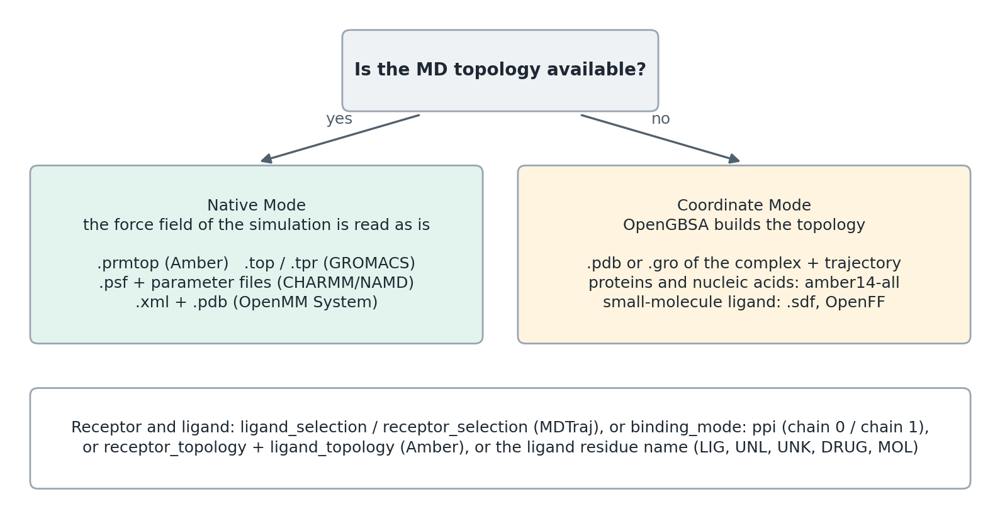

Input formats and modes
=======================

OpenGBSA needs two things: a description of the system and an MD trajectory.
How the system is described decides the mode. In **Native Mode** OpenGBSA
reads the topology that was used for the simulation, so the energies use
exactly that force field. In **Coordinate Mode** the input has coordinates but
no topology, and OpenGBSA builds the topology itself from a force field. The
mode follows from the file given as ``input_files.complex_pdb``; there is no
separate switch.

   Native Mode for a topology of the simulation, Coordinate Mode for
   coordinates alone. In both modes the receptor and the ligand are chosen the
   same way.

.. list-table::
   :header-rows: 1
   :widths: 22 30 48

   * - Program
     - ``complex_pdb``
     - Also needed
   * - Amber
     - ``.prmtop``
     - trajectory (``.nc``, ``.dcd``, ``.mdcrd``/``.trj``, ``.xtc``)
   * - GROMACS
     - ``.top`` or ``.tpr``
     - a ``.gro`` next to the ``.top``; trajectory (``.xtc``, ``.trr``)
   * - CHARMM / NAMD
     - ``.psf``
     - ``charmm_params``; coordinates; trajectory (``.dcd``)
   * - OpenMM
     - ``.xml`` (serialised System)
     - a ``.pdb`` of the same name; trajectory
   * - any (Coordinate Mode)
     - ``.pdb`` or ``.gro``
     - trajectory; ``ligand_mol`` for a small-molecule ligand

Trajectories are read with MDTraj, so every format MDTraj reads works,
including multi-model PDB files.

Water and ions
--------------

The trajectory may contain water and ions. If it does and the topology
describes only the complex, give the topology of the simulated system as
``solvated_topology`` (a ``.gro``, ``.pdb`` or solvated ``.prmtop``) so that the
trajectory can be read. OpenGBSA then removes the solvent and ions itself. It
removes the residues ``WAT``, ``HOH``, ``H2O``, ``SOL``, ``TIP3``, ``TIP``,
``SPC`` and the ions ``NA``, ``CL``, ``K``, ``MG``, ``ZN``, ``CA`` (also in
their charged, CHARMM and GROMACS spellings: ``Na+``, ``SOD``, ``CLA``, ``POT``,
``CAL``, ``ZN2`` and others). Metal ions bound to the receptor are therefore
removed as well; keep them under a different residue name if they belong to
the complex.

Before any energy is computed, the trajectory is re-imaged so that every
molecule is whole and the receptor and the ligand are in the same periodic
image (``reimage_trajectory: true``, the default).

Native Mode
-----------

Amber
~~~~~

.. code-block:: yaml

    input_files:
      complex_pdb: complex.prmtop          # topology of the dry complex
      trajectory: production.nc
      solvated_topology: solvated.prmtop   # only if the trajectory contains solvent
      receptor_topology: receptor.prmtop   # optional
      ligand_topology: ligand.prmtop       # optional

The GB radii stored in the ``.prmtop`` are kept, as Amber MMPBSA.py does.
OpenGBSA warns when they differ from the set that the GB model was
parameterised with. With ``receptor_topology`` and ``ligand_topology`` the
ligand is defined by their atom counts: the receptor atoms come first in the
complex and the ligand atoms follow. CHARMM systems written as Amber chamber
files work the same way.

GROMACS
~~~~~~~

.. code-block:: yaml

    input_files:
      complex_pdb: topol.top
      trajectory: md.xtc

A ``.top`` is converted to Amber topologies with ParmEd, with the ``.gro`` of
the same folder (same name preferred) for the coordinates and with every file
it ``#include``\ s. The converted files ``<name>_solvated.prmtop``,
``<name>_dry.prmtop``, ``receptor.prmtop`` and ``ligand.prmtop`` are written next
to the ``.top``. For this split the ligand residue must be named ``LIG``,
``UNL`` or ``UNK``. GB radii are assigned for the chosen GB model, because
GROMACS topologies have none.

A ``.tpr`` is read directly with TprParser. For CHARMM force fields use the
``.top``: the ``.tpr`` reader takes one Lennard-Jones parameter set per atom
type and so cannot apply CHARMM's pair-specific corrections (NBFIX). OpenGBSA
warns in that case.

.. _charmm-namd:

CHARMM / NAMD
~~~~~~~~~~~~~

.. code-block:: yaml

    input_files:
      complex_pdb: system.psf
      trajectory: production.dcd
      solvated_topology: system.pdb          # coordinates of the psf atoms
    forcefield_settings:
      charmm_params:                         # every parameter file of the simulation
        - par_all36m_prot.prm
        - toppar_water_ions_prot.str
    analysis_settings:
      binding_mode: ppi                      # or ligand_selection / receptor_selection

A ``.psf`` carries no parameters and no coordinates. The parameter files go
under ``forcefield_settings.charmm_params`` and the coordinates come from
``solvated_topology`` or ``forcefield_settings.charmm_coordinates``. CHARMM's
pair-specific Lennard-Jones corrections (NBFIX) are applied. GB radii are
assigned for the chosen GB model.

OpenMM
~~~~~~

.. code-block:: yaml

    input_files:
      complex_pdb: system.xml     # openmm.XmlSerializer.serialize(system)
      trajectory: production.dcd  # system.pdb must sit next to system.xml

A serialised OpenMM ``System`` is read together with a PDB file of the same
atoms and the same name, which gives the atom names, residues and chains. The
System is converted to an Amber topology with ParmEd and then runs in Native
Mode. GB radii are assigned for the GB model (``gb_radii_set`` chooses another
set). Systems whose force field uses only the standard OpenMM forces convert
exactly. A ``CustomNonbondedForce`` or another custom force, for example the
NBFIX terms of a CHARMM system built in OpenMM, cannot be converted; OpenGBSA
then stops and asks for the original topology.

.. _coordinate-mode:

Coordinate Mode
---------------

.. code-block:: yaml

    input_files:
      complex_pdb: complex.pdb       # receptor and ligand, with hydrogens
      trajectory: trajectory.xtc
      ligand_mol: ligand.sdf         # small-molecule ligand: bond orders and charges
    forcefield_settings:
      protein_forcefield: amber      # amber (ff14SB), amber14, charmm

OpenGBSA builds the topology with OpenMM. Proteins and nucleic acids receive
Amber ff14SB (``protein_forcefield: amber``, the default) or OpenMM's
``amber14-all`` set (``amber14``), which also covers DNA and RNA (OL15). A
small-molecule ligand needs ``ligand_mol``, an ``.sdf`` file (or ``.mol2``)
with bond orders and, if available, partial charges; it is parameterised with
OpenFF. The PDB must contain every atom of the force field's residue templates,
including hydrogens. The rebuilt topology can differ from the one used in the
simulation, for example in partial charges or in the placement of atoms that
were missing.

.. _receptor-and-ligand:

Receptor and ligand
-------------------

OpenGBSA computes the binding of a ligand to a receptor. The ligand can be a
small molecule, a peptide, a protein chain or a nucleic acid. It is chosen in
this order:

1. ``analysis_settings.ligand_selection`` and ``receptor_selection``: MDTraj
   selections such as ``"chainid 1"``, ``"resid 288 to 312"`` or
   ``"resname LIG"``. Residue and chain indices count from 0 in the order of
   the topology after water and ions are removed; ``chainid`` is this index,
   not the chain letter of a PDB file.
2. ``binding_mode: ppi``: the receptor is chain 0 and the ligand is chain 1.
3. ``receptor_topology`` and ``ligand_topology`` (Amber): their atom counts.
4. Otherwise every residue with the first of the names ``LIG``, ``UNL``,
   ``UNK``, ``DRUG`` and ``MOL`` that occurs, or else the residue name with the
   fewest atoms in total, if that is under 200.

Everything that is not the ligand is the receptor, unless
``receptor_selection`` says otherwise. The log reports the number of receptor
and ligand atoms; check it on a new system.

.. _opt-binding_mode:

``binding_mode``
~~~~~~~~~~~~~~~~

:Default: ``standard``
:Values: ``standard``, ``ppi``

``standard`` finds the ligand by the rules above. ``ppi`` is for two-chain
complexes: the receptor is chain 0 and the ligand chain 1. A complex with one
chain or with more than two chains stops with an error that asks for
``ligand_selection`` and ``receptor_selection``; with both selections given,
the chains are not counted. A topology without chain records, such as an Amber
``.prmtop``, has a single chain, so use selections there. The older value
``dimer_ligand`` is accepted as ``standard``, with a warning.

.. _opt-ligand_selection:

``ligand_selection`` and ``receptor_selection``
~~~~~~~~~~~~~~~~~~~~~~~~~~~~~~~~~~~~~~~~~~~~~~~

:Default: none
:Values: MDTraj selection strings

They override ``binding_mode``. With only ``ligand_selection`` the receptor is
every other atom, and with only ``receptor_selection`` the ligand is. A
selection that matches no atom, and receptor and ligand selections that share
atoms, stop the run with an error. Atoms in neither selection, for example a
third chain, are left out of the calculation; the log and ``final_report.txt``
say how many.

.. code-block:: yaml

    analysis_settings:
      ligand_selection: "chainid 2"
      receptor_selection: "chainid 0 1"     # two receptor chains, for example an antibody

The input_files options
-----------------------

.. _opt-complex_pdb:

``complex_pdb``
~~~~~~~~~~~~~~~

:Values: a file path; required

The system. Its extension decides the mode: ``.prmtop``, ``.parm7``, ``.top``,
``.tpr``, ``.psf`` and an OpenMM ``.xml`` start Native Mode; ``.pdb`` and
``.gro`` start Coordinate Mode. A GROMACS ``.top`` and an OpenMM ``.xml`` are
first converted to Amber topologies.

.. _opt-trajectory:

``trajectory``
~~~~~~~~~~~~~~

:Values: a file path; required

The MD trajectory, in any format MDTraj reads. OpenGBSA reads the whole file
before it chooses the frames. For a very long trajectory, writing only the
frames you need to a smaller file, for example with ``cpptraj`` or
``gmx trjconv``, saves time and memory.

.. _opt-solvated_topology:

``solvated_topology``
~~~~~~~~~~~~~~~~~~~~~

:Default: none
:Values: a ``.gro``, ``.pdb`` or ``.prmtop`` file

The topology of the atoms in the trajectory when the trajectory still contains
water and ions and ``complex_pdb`` describes only the complex. OpenGBSA reads
the trajectory with it and then removes the solvent (`Water and ions`_). For
``.psf`` input it also gives the coordinates.

.. _opt-receptor_topology:

``receptor_topology`` and ``ligand_topology``
~~~~~~~~~~~~~~~~~~~~~~~~~~~~~~~~~~~~~~~~~~~~~

:Default: none
:Values: Amber ``.prmtop``, ``.parm7`` or ``.new`` files

Native Mode with Amber input. The receptor atoms come first in the complex
topology and the ligand atoms follow; the atom count of the receptor topology
defines where the ligand starts. The parameters of receptor and ligand are
read from these files. Another file type stops the run with an error. In
Coordinate Mode the two files are not used, and the log says so.

.. _opt-ligand_mol:

``ligand_mol``
~~~~~~~~~~~~~~

:Default: none
:Values: an ``.sdf`` or ``.mol2`` file

Coordinate Mode only. The small-molecule ligand with bond orders and, if
available, partial charges. It is parameterised with OpenFF. Charges in the
file are kept. Without them, charges are computed with ``charge_method``
(``analysis_settings``; ``am1bcc`` by default, or ``mmff94`` or ``gasteiger``).
AM1-BCC needs AmberTools' ``sqm``; if it fails, the run stops and asks for
charges in the file or another method. The ligand is found by its residue
name (rule 4 above), so ``ligand_mol`` cannot be combined with
``ligand_selection``: a selected ligand is built with the protein force field.
A configuration with both stops with an error.

``ligand_pdb`` and ``ligand_resname``
~~~~~~~~~~~~~~~~~~~~~~~~~~~~~~~~~~~~~

:Default: none

``ligand_pdb`` is a PDB file of the ligand alone. OpenGBSA only checks that its
residue names occur in the complex. ``ligand_resname`` is the residue name
shown in the ligand box of the interactive 3D view. Neither changes which atoms
are the ligand.
