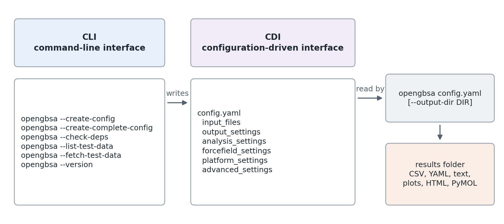

CLI and CDI: the two interfaces
===============================

OpenGBSA has two interfaces that work together. The **command-line interface
(CLI)** is the ``opengbsa`` command. It prepares a run: it writes configuration
templates, checks the installation and downloads test data. The
**configuration-driven interface (CDI)** is a YAML file that defines one
calculation completely: the input files, the solvation model, the frames, the
analyses and the hardware. ``opengbsa config.yaml`` runs it. Because the file
holds every setting, it documents the calculation and can be rerun or shared
as it is.

   The CLI commands and the sections of a CDI configuration file. A run reads
   the configuration and writes a results folder.

A typical session
-----------------

.. code-block:: bash

    opengbsa --check-deps                  # once, after installation
    opengbsa --create-config               # writes mmgbsa_config.yaml
    nano mmgbsa_config.yaml                # set the input files and options
    opengbsa mmgbsa_config.yaml            # run; results in mmgbsa_results/analysis_<date>_<time>/

The command line
----------------

.. code-block:: text

    opengbsa [config_file] [options]

.. list-table::
   :header-rows: 1
   :widths: 32 68

   * - Command
     - What it does
   * - ``opengbsa config.yaml``
     - Validates the configuration and runs the analysis it defines. Exits
       with status 0 on success and 1 on any error.
   * - ``--output-dir DIR``
     - Writes the results to ``DIR/mmgbsa_analysis_<date>_<time>/`` instead
       of the folder named in the configuration.
   * - ``--create-config``
     - Writes ``mmgbsa_config.yaml`` in the current folder: a short template
       with the options most runs need. Asks before overwriting.
   * - ``--create-complete-config``
     - Writes ``complete_mmgbsa_config.yaml``: every option the analysis
       reads, set to its default, with a comment on each.
   * - ``--check-deps``
     - Imports every dependency and reports the missing ones. Exits with
       status 1 if one is missing.
   * - ``--version``
     - Prints the version, licence and repository.
   * - ``--list-test-data``
     - Lists the test datasets that can be downloaded, without downloading.
   * - ``--fetch-test-data [--only NAME]``
     - Downloads the test datasets from Zenodo, checks their SHA-256 sums,
       caches them in ``~/.cache/opengbsa`` and links them into
       ``test/data/`` of the repository (run it from the repository root).
       ``--only`` takes a comma-separated list of dataset names.
   * - ``--force-refetch``
     - With ``--fetch-test-data``: downloads again even if a valid copy is
       cached.
   * - ``--verbose``, ``-v``
     - More detail from the Python ``logging`` messages.
   * - ``--log-file FILE``
     - Also writes the Python ``logging`` messages to ``FILE``. To keep the
       complete console output of a run, redirect it instead:
       ``opengbsa config.yaml 2>&1 | tee run.log``.
   * - ``--complete``
     - Deprecated and ignored. Every run uses the same pipeline.

The configuration file
----------------------

A configuration file has up to eight sections. Only ``input_files`` and
``analysis_settings`` are required; every option that is left out takes its
default. :doc:`configuration` lists every option.

.. list-table::
   :header-rows: 1
   :widths: 26 74

   * - Section
     - Contents
   * - ``input_files``
     - The topology or structure, the trajectory and optional receptor,
       ligand and solvated topologies.
   * - ``output_settings``
     - The folder for the results.
   * - ``analysis_settings``
     - The GB model, salt, temperature, receptor and ligand, frames,
       per-residue decomposition, entropy and ``amber_compatible``.
   * - ``forcefield_settings``
     - The protein force field of Coordinate Mode and the CHARMM parameter
       files of ``.psf`` input.
   * - ``platform_settings``
     - CPU, CUDA or OpenCL, and whether a fallback is allowed.
   * - ``advanced_settings``
     - Worker processes of the per-residue decomposition on the CPU.
   * - ``reporting_settings``
     - Options of the interactive HTML report.

A minimal file for an Amber system:

.. code-block:: yaml

    input_files:
      complex_pdb: complex.prmtop
      trajectory: production.nc
    analysis_settings:
      gb_model: OBC2
      max_frames: 100

The values are checked before the run starts. A missing input file, an unknown
GB model or a value out of range stops the run with a message that names the
option. Relative paths are read from the folder where ``opengbsa`` is started.

The Python interface
--------------------

The same pipeline can be called from Python, for example in a notebook:

.. code-block:: python

    import yaml
    from mmgbsa.runner import MMGBSARunner

    config = yaml.safe_load(open("config.yaml"))
    results = MMGBSARunner(config, output_dir="results").run_analysis()
    print(results["mmgbsa"]["mean_binding_energy"])

The Python interface skips the validation of the command line, so check a new
configuration with ``opengbsa`` first.
