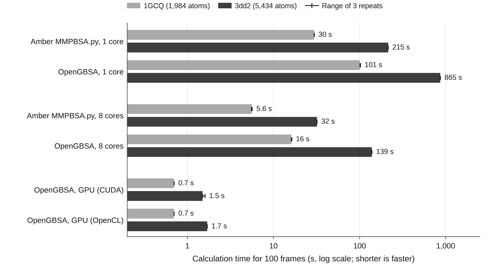

Running an analysis
===================

.. code-block:: bash

    opengbsa config.yaml
    opengbsa config.yaml --output-dir results     # results/mmgbsa_analysis_<date>_<time>/

A run goes through numbered steps that the log announces: configuration
validation, output setup, calculator setup, the MM/GBSA calculation, the
entropy estimate and the per-residue decomposition (when requested), the final
report and the saved results. It ends with the mean binding enthalpy and the
results folder.

Platforms
---------

All energies are computed by OpenMM on one of its platforms:

* **CUDA** on NVIDIA GPUs, in mixed precision.
* **OpenCL** on NVIDIA, AMD, Intel and Apple GPUs.
* **CPU**, with the frames divided among worker processes.
* **Reference**, a slow double-precision implementation for checks.

Before using a GPU platform OpenGBSA compiles and runs a small test
calculation, so a GPU that cannot run OpenMM's code (for example because the
CUDA runtime is newer than the driver) is detected at the start. The log names
the platform in the line ``Running on OpenMM platform: ...`` and
``results_summary.yaml`` records it as ``platform_used``.
:doc:`../installation` explains how to match the CUDA runtime to the driver.
The platform changes the result only in the last digits. GPUs compute in mixed
precision and the CPU platforms in double precision. For the validation
systems the mean binding enthalpies on CUDA and CPU agreed within 0.001
kcal/mol, and within 0.02 kcal/mol for the 8,800-atom antibody complexes.

.. code-block:: yaml

    platform_settings:
      preferred_platform: CUDA        # CUDA, OpenCL, CPU or Reference
      decomposition_platform: CUDA    # platform of the per-residue decomposition
      strict_platform: false          # true: stop instead of falling back
    analysis_settings:
      max_workers: 4                  # CPU platform: worker processes
      print_interval: 10              # progress line every N frames
      verbose: true                   # false: fewer messages
    advanced_settings:
      n_jobs: -1                      # CPU decomposition: processes, -1 = all cores

.. _opt-preferred_platform:

``preferred_platform``
~~~~~~~~~~~~~~~~~~~~~~

:Default: automatic
:Values: ``CUDA``, ``OpenCL``, ``CPU``, ``Reference``, in any letter case

The OpenMM platform of the calculation. Without it OpenGBSA uses the platform
named in the environment variable ``OPENMM_DEFAULT_PLATFORM`` or, if that is not
set, the first that works of CUDA, OpenCL and CPU. When the requested platform
cannot be used, the log shows a ``PLATFORM FALLBACK`` warning and the run
continues on the next one. CUDA and OpenCL use mixed precision and the first
GPU the program can see; choose another GPU with ``CUDA_VISIBLE_DEVICES``, for
example ``CUDA_VISIBLE_DEVICES=1 opengbsa config.yaml``.

.. _opt-decomposition_platform:

``decomposition_platform``
~~~~~~~~~~~~~~~~~~~~~~~~~~

:Default: the platform of the calculation
:Values: as ``preferred_platform``

The platform of the per-residue decomposition. The per-atom energies are
computed with NumPy; this platform computes each decomposed frame's complex,
receptor and ligand energies, against which OpenGBSA checks them
(:doc:`decomposition`). With ``CPU`` the frames are divided among
``advanced_settings.n_jobs`` processes; with a GPU platform they are decomposed
one after another in one process.

.. _opt-strict_platform:

``strict_platform``
~~~~~~~~~~~~~~~~~~~

:Default: ``false``
:Values: ``true``, ``false``

``true`` stops the run with an error when the requested platform cannot be
used, instead of falling back. Use it in scripts and benchmarks, where a silent
fallback would go unnoticed.

CPU runs
--------

.. _opt-max_workers:

``max_workers``
~~~~~~~~~~~~~~~

:Default: one less than the number of cores, at most 4
:Values: a positive whole number

On the CPU platform the frames are divided among this many worker processes.
Each worker builds the three OpenMM systems once and evaluates its share of the
frames; the OpenMM threads are divided among the workers. On a GPU the frames
are evaluated one after another in one process and ``max_workers`` has no
effect.

.. _opt-n_jobs:

``n_jobs``
~~~~~~~~~~

:Default: ``-1``
:Values: ``-1`` (every core) or a positive whole number

Section ``advanced_settings``. The number of processes of a per-residue
decomposition with ``decomposition_platform: CPU``. 1 runs it in one process.

Progress messages
-----------------

.. _opt-print_interval:

``print_interval``
~~~~~~~~~~~~~~~~~~

:Default: ``10``
:Values: a positive whole number

A progress line with the energies of the frame is printed for the first five
frames and then for every ``print_interval``-th frame.

.. _opt-verbose:

``verbose``
~~~~~~~~~~~

:Default: ``true``
:Values: ``true``, ``false``

``false`` leaves out informational messages, for example about the platform
choice. Warnings and results are always printed. The command-line flag
``--verbose`` is separate: it switches Python's ``logging`` messages to the
debug level.

Run time
--------

On a GPU a frame of a complex of 1,895 to 5,434 atoms takes 6 to 15 ms. The
per-residue decomposition is slower, because every receptor residue is
evaluated separately. The figure shows the calculation time for 100 frames of
two complexes from the OpenGBSA paper on an Intel Core i9-9900K (8 cores) and
an NVIDIA RTX 2080 SUPER, with Amber MMPBSA.py for comparison.

   Calculation time for 100 frames, median of three repeats. On the GPU,
   OpenGBSA was about 8 and 21 times faster than MMPBSA.py with eight MPI
   ranks on the two systems. On eight CPU cores MMPBSA.py was faster.

Logs
----

The console output of a run is the complete log. Keep it with

.. code-block:: bash

    opengbsa config.yaml 2>&1 | tee run.log

``--log-file FILE`` writes only the messages of Python's ``logging`` module.

Long runs and many systems
--------------------------

A configuration describes one complex. For a series, write one configuration
per complex and run them one after another, for example with a shell loop:

.. code-block:: bash

    for c in configs/*.yaml; do opengbsa "$c" 2>&1 | tee "${c%.yaml}.log"; done

On a cluster, submit one job per configuration. Each run writes its own
time-stamped folder, so runs never overwrite each other.
