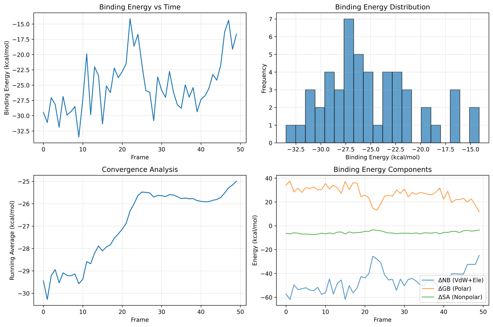
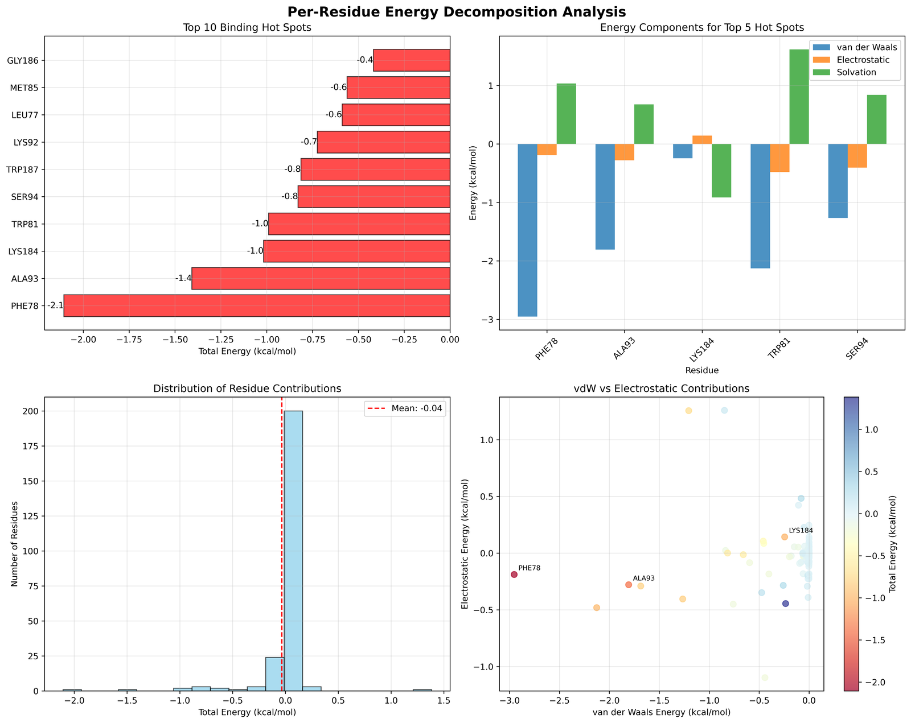
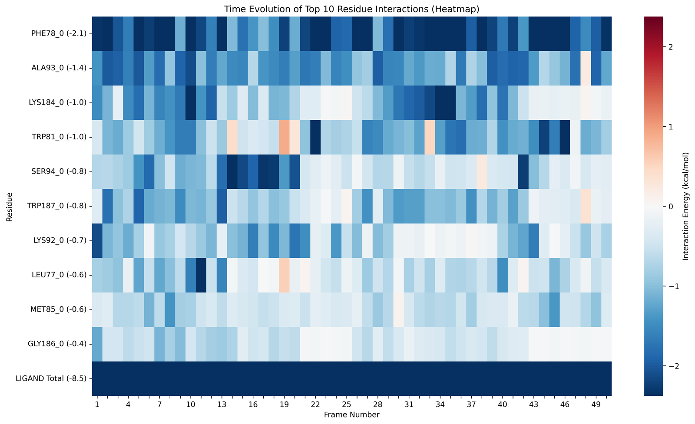
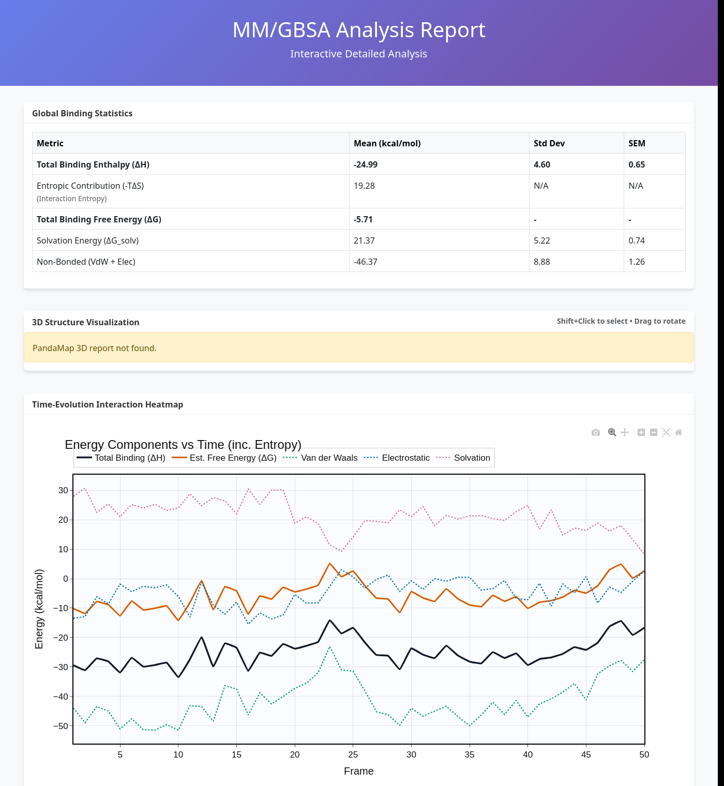
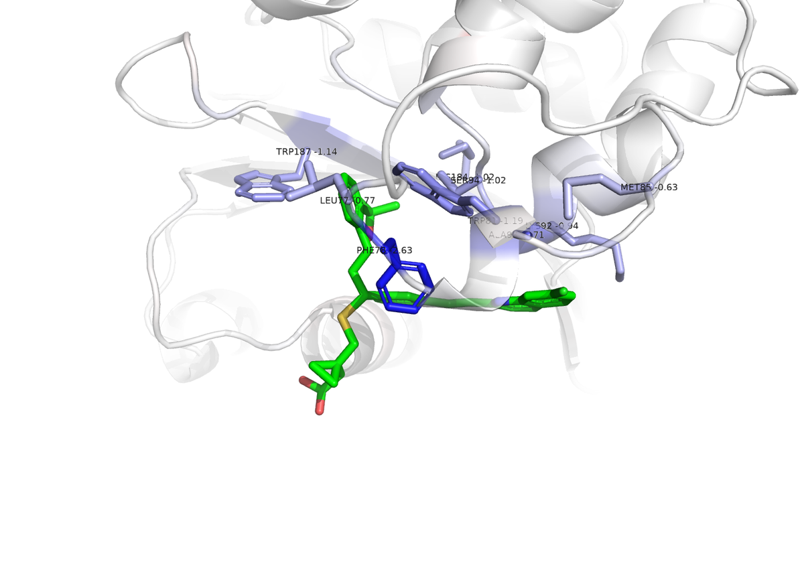

Plots, report and 3D views
==========================

Every run draws its results. The examples on this page come from the
:doc:`../quickstart` (6T1H with ligand 1151, 50 frames).

Binding enthalpy over the trajectory
------------------------------------

``energy_analysis.png`` is written by every run.

   Top left: :math:`\Delta H_\mathrm{bind}` of each frame. Top right: its
   distribution. Bottom left: the running average. Bottom right: the terms of
   each frame, the gas-phase interaction energy (van der Waals plus
   electrostatic), the polar solvation (GB) and the non-polar solvation (SA).

Read it in this order. The time series shows whether the complex stays in one
binding mode; a jump points to a change of pose. The running average should
level off; if it still drifts at the end, more frames are needed. The terms
show what drives binding. In most complexes the favourable gas-phase
interaction is partly paid back by the polar desolvation, as here.

Per-residue contributions
-------------------------

With ``run_per_residue_decomposition: true`` the run adds two plots.

   ``per_residue_decomposition.png``: the residues that contribute most (top
   left), their van der Waals, electrostatic and solvation terms (top right),
   the distribution over all residues (bottom left) and van der Waals against
   electrostatic contributions (bottom right). The bars show the ``total``
   column of ``per_residue_detailed.csv``.

   ``per_residue_heatmap.png``: the contribution of the top residues in every
   decomposed frame. A residue that is favourable in every frame is a stable
   hot spot; one that switches sign marks a contact that forms and breaks.

Interactive report
------------------

``interactive_report.html`` collects the results in one page that opens in any
browser, without a server. It has a summary table with the binding enthalpy,
the entropy estimate and the free energy, zoomable time series of every term,
the average terms, the per-residue table and, when the optional package
PandaMap is installed (``pip install pandamap``), a 3D view of the binding site.
Every plot can be exported with the camera button.

   The top of ``interactive_report.html`` of the quickstart.

PyMOL view of the hot spots
---------------------------

The per-residue decomposition also writes ``hotspots.pdb`` and
``view_binding.pml``. Each receptor atom of ``hotspots.pdb`` carries the
contribution of its residue (``total + nonpolar_solvation`` of
``per_residue_detailed.csv``) as B-factor, and the segment identifier marks
receptor (``REC``) and ligand (``LIG``) atoms. The residues keep the numbers
of the decomposition tables. Open the view from the results folder:

.. code-block:: bash

    cd quickstart_results/analysis_<date>_<time>
    pymol view_binding.pml

   The receptor is coloured from blue (favourable) through white to red
   (unfavourable). The ligand is green. Residues that contribute less than
   -0.5 kcal/mol are shown as sticks and labelled with their contribution.

The script is plain PyMOL commands, so it is easy to adapt, for example to a
different threshold (the ``b < -0.5`` selection) or colour range (the
``spectrum`` line). Other viewers can use the B-factors of ``hotspots.pdb`` in
the same way, for example ChimeraX with ``color bfactor``.

Your own figures
----------------

All plotted numbers are in the CSV and YAML files (:doc:`outputs`), so any
plot can be redrawn. For example, the binding enthalpy over the frames with
pandas and matplotlib:

.. code-block:: python

    import glob
    import pandas as pd
    import matplotlib.pyplot as plt

    frames = pd.read_csv(glob.glob("quickstart_results/*/fixed_enhanced_mmgbsa_results_obc2.csv")[0])
    plt.plot(frames.frame, frames.binding_energy)
    plt.xlabel("frame")
    plt.ylabel("binding enthalpy (kcal/mol)")
    plt.savefig("binding_enthalpy.png", dpi=300)
